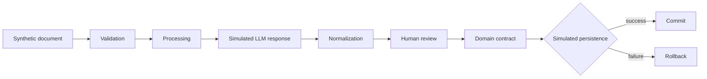

# LLM Document Workflows

[Português](README.md) · [English](README.en.md)

[](https://github.com/LariMaury/llm-document-workflows/actions/workflows/tests.yml)

A runnable technical portfolio selectively derived from engineering components of a private educational platform. This project does not rebuild the product: it presents isolated algorithms, synthetic data, reproducible tests, and explicit public boundaries.

- **Author:** Maurylia Loureiro
- **GitHub:** [github.com/LariMaury](https://github.com/LariMaury)
- **Contact:** [mauryliapro@gmail.com](mailto:mauryliapro@gmail.com)

## Engineering capabilities

- **AI Engineering:** structured outputs, defensive normalization, validation, and human-in-the-loop controls.
- **Backend Engineering:** domain contracts, resource limits, error handling, and transactional design.
- **Full Stack Engineering:** a documented path from user input to processing, review, and persistence.
- **Automation and reliability:** bounded concurrency, backpressure, selective retry, cancellation, and cleanup.
- **Quality engineering:** 36 automated tests and CI on Node.js 22 and 24.

## Executable workflow



No LLM is called. The simulated response can never persist directly: it is normalized, reviewed, and validated before reaching the in-memory transaction.

## Components

| Component | Public implementation | Relationship to the original code |
|---|---|---|
| LLM Integration & Human-in-the-Loop | `src/llm/normalize-activity.js` | adapted normalizer; demo-only review gate |
| Secure Document Ingestion | `src/ingestion/secure-document-ingestion.js` | adapted size limits, ZIP validation, timeout, and extraction |
| Transactional Data Contracts | `src/contracts/` | adapted contracts; demo-only in-memory commit/rollback |
| Asynchronous Processing | `src/async/resilient-processing.js` | adapted queue, backpressure, and retry policies |

The [source and adaptation map](docs/source-map.md) identifies every original file and function and classifies extracted, adapted, and demo-only code.

## Local execution

Requirement: Node.js 22 or newer, matching the PDF-processing dependency requirement.

```bash
npm ci --ignore-scripts
npm test
npm run demo
```

No environment variables, external accounts, or credentials are required.

The [Tests](.github/workflows/tests.yml) workflow runs `npm ci --ignore-scripts` and `npm test` on Node.js 22 and 24 for pushes and pull requests targeting `main`. It has read-only permissions, uses no secrets, and performs no deployment.

## Verified result

Observed on November 16, 2026, with Node.js `v24.13.0`:

- **36/36 tests passed**;
- 0 failures, 0 skipped tests, and 0 pending tests;
- synthetic TXT, DOCX, and PDF documents processed locally;
- 2 questions normalized and 1 inconsistent question discarded;
- simulated commit and rollback confirmed;
- 1 transient failure recovered through controlled retry;
- 0 known vulnerabilities in the final `npm audit --omit=dev`;
- **0 external calls** during the demo.

See [testing and results](docs/testing.md) and the [generated report](artifacts/demo-report.md). The observed duration is not presented as a benchmark.

## Architecture and documentation

- [Architecture](docs/architecture.md)
- [LLM integration](docs/llm-integration.md)
- [Source and adaptation map](docs/source-map.md)
- [Demo guide](docs/demo-guide.md)
- [Security and privacy](docs/security-and-privacy.md)
- [Testing and results](docs/testing.md)

## Scope and limitations

- The repository does not include the UI, complete business rules, or infrastructure of the private source platform.
- Private pedagogical prompts, Supabase adapters, and real configurations are excluded.
- Documents and LLM responses are entirely synthetic.
- Persistence is a local simulation; it does not claim that PostgreSQL, transactions, or RLS run in this repository.
- Results belong to this isolated portfolio and are not represented as tests of the original platform.
- Experimental source-platform features are not presented as production capabilities.

## Publication status

No open-source license has been added. The original work remains all rights reserved, as described in the [rights and dependency notice](NOTICE.md).
