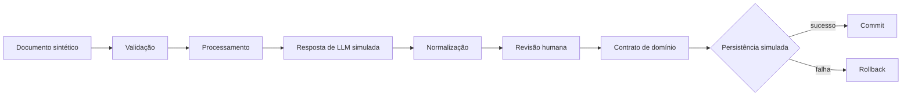

# LLM Document Workflows

[Português](README.md) · [English](README.en.md)

[](https://github.com/LariMaury/llm-document-workflows/actions/workflows/tests.yml)

Portfólio técnico demonstrável derivado seletivamente de componentes de engenharia de uma plataforma educacional privada. Este projeto não reconstrói o produto: apresenta algoritmos isolados, dados sintéticos, testes reproduzíveis e limites públicos explícitos.

- **Autora:** Maurylia Loureiro
- **GitHub:** [github.com/LariMaury](https://github.com/LariMaury)
- **Contato:** [mauryliapro@gmail.com](mailto:mauryliapro@gmail.com)

## Competências demonstradas

- **Engenharia de IA:** respostas estruturadas, normalização defensiva, validação e human-in-the-loop.
- **Backend:** contratos de domínio, tratamento de erros, limites de recursos e desenho transacional.
- **Full Stack:** relação documentada entre entrada do usuário, processamento, revisão e persistência.
- **Automação e resiliência:** concorrência limitada, backpressure, retry seletivo, cancelamento e limpeza.
- **Qualidade:** 36 testes automatizados e CI em Node.js 22 e 24.

## Fluxo executável



Nenhum LLM é chamado. A resposta simulada nunca persiste diretamente: ela é normalizada, revisada e validada antes de chegar à transação em memória.

## Componentes

| Componente | Implementação pública | Relação com o código original |
|---|---|---|
| LLM Integration & Human-in-the-Loop | `src/llm/normalize-activity.js` | normalizador adaptado; gate de revisão criado para a demo |
| Secure Document Ingestion | `src/ingestion/secure-document-ingestion.js` | limites, ZIP, timeout e extração adaptados |
| Transactional Data Contracts | `src/contracts/` | contratos adaptados; commit/rollback em memória criado para a demo |
| Asynchronous Processing | `src/async/resilient-processing.js` | fila, backpressure e retry adaptados |

O [mapa de origem e adaptações](docs/source-map.md) identifica cada arquivo e função original e classifica o que foi adaptado ou criado exclusivamente para demonstração.

## Execução local

Requisito: Node.js 22 ou superior, conforme o requisito da dependência de processamento PDF.

```bash
npm ci --ignore-scripts
npm test
npm run demo
```

Não são necessárias variáveis de ambiente, contas externas ou credenciais.

O workflow [Tests](.github/workflows/tests.yml) executa `npm ci --ignore-scripts` e `npm test` em Node.js 22 e 24 para pushes e pull requests direcionados à `main`. Ele possui permissão somente de leitura, não usa segredos e não realiza deploy.

## Resultado verificado

Em 16 de novembro de 2026, com Node.js `v24.13.0`:

- **36/36 testes aprovados**;
- 0 falhas, 0 skips e 0 testes pendentes;
- TXT, DOCX e PDF sintéticos processados localmente;
- 2 questões normalizadas e 1 descartada por inconsistência;
- commit e rollback simulados confirmados;
- 1 falha transitória recuperada com retry controlado;
- 0 vulnerabilidades conhecidas no `npm audit --omit=dev` final;
- **0 chamadas externas** durante a demonstração.

Consulte [testes e resultados](docs/testing.md) e o [relatório gerado](artifacts/demo-report.md). A duração observada não é apresentada como benchmark.

## Arquitetura e documentação

- [Arquitetura](docs/architecture.md)
- [Integração com LLMs](docs/llm-integration.md)
- [Mapa de origem e adaptações](docs/source-map.md)
- [Guia da demonstração](docs/demo-guide.md)
- [Segurança e privacidade](docs/security-and-privacy.md)
- [Testes e resultados](docs/testing.md)

## Escopo e limitações

- O projeto não contém a interface, regras completas ou infraestrutura da plataforma privada de origem.
- Os prompts pedagógicos, adaptadores Supabase e configurações privadas foram omitidos.
- Os documentos e respostas de LLM são integralmente sintéticos.
- A persistência é uma simulação local; não comprova PostgreSQL, transações ou RLS em execução neste repositório.
- Os resultados pertencem à vitrine local e não representam testes executados na plataforma original.
- Recursos experimentais da plataforma de origem não são apresentados como produção.

## Publicação

Nenhuma licença de código aberto foi adicionada. O código permanece com todos os direitos reservados, conforme o [aviso de direitos e dependências](NOTICE.md).
