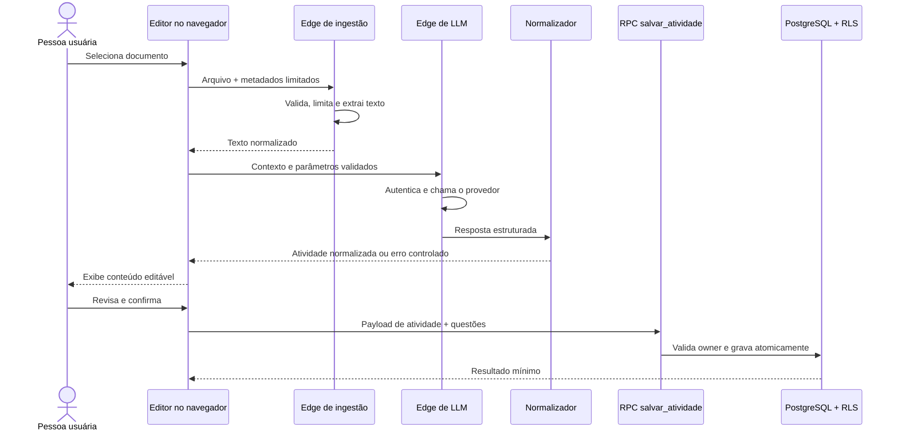

# Arquitetura da seleção técnica

Este documento separa a arquitetura confirmada no produto privado de origem do recorte executável deste portfólio. Os quatro componentes públicos possuem implementação local e testes independentes; o [mapa de origem](source-map.md) registra cada adaptação.

## 1. Escopo

Os caminhos citados nas seções de origem pertencem ao repositório privado e não são dependências deste projeto. A demonstração pública usa somente módulos locais, fixtures sintéticas e persistência em memória explicitamente simulada.

As quatro áreas escolhidas formam dois fluxos relacionados:

1. geração de atividade a partir de documento ou instrução textual;
2. processamento progressivo de páginas para leitura e revisão assistida.

O primeiro fluxo possui núcleo de persistência implementado. Partes mais recentes do segundo fluxo — alunos, snapshots V3, correções persistentes, lotes e relatórios — foram documentadas como validadas apenas em staging e, por isso, permanecem experimentais nesta apresentação.

## 2. Produto de origem — contexto documentado, não executado aqui

### Navegador

Responsabilidades confirmadas:

- seleção e validação inicial de arquivos;
- renderização progressiva de páginas PDF;
- edição e revisão do conteúdo normalizado;
- estado de interface e cancelamento;
- construção do payload de domínio;
- chamadas ao gateway de dados.

Evidências de origem:

- `site/app.js:1889` — início da geração de atividade por IA;
- `site/app.js:1961` — chamada ao gateway de geração;
- `site/app.js:1984` e `site/app.js:2040` — inserção da resposta no editor;
- `site/app.js:2644` — ação de salvamento revisado;
- `site/app.js:4339`–`4477` — inspeção e renderização de PDFs;
- `site/app.js:5347`–`5418` — processamento progressivo com liberação de recursos.

### Gateway de dados

`site/dados.js` oferece uma interface assíncrona comum para modo demonstrativo e Supabase. Os pontos mais relevantes para esta seleção são:

- `apiSupabase.gerarAtividadeIA` — invoca a Edge Function de geração;
- `apiSupabase.processarMaterialAtividade` — envia documento à extração segura;
- `apiSupabase.lerFolhaRespostas` — envia uma página preparada ao leitor multimodal;
- `apiSupabase.salvarConjunto` — usa exclusivamente a RPC transacional `salvar_atividade`.

O gateway não constitui uma API REST própria. Ele consome Supabase Auth, PostgREST, RPCs PostgreSQL e Edge Functions.

### Edge Functions

Responsabilidades confirmadas:

- autenticação do token no servidor;
- verificação de existência do perfil;
- leitura de segredos somente no ambiente server-side;
- validação e limitação de entradas;
- chamada ao provedor de LLM;
- normalização e limitação da saída antes de responder ao navegador.

Arquivos prioritários:

- `site/supabase/functions/gerar-atividade-ia/index.ts`;
- `site/supabase/functions/processar-material-atividade/index.ts`;
- `site/supabase/functions/ler-folha-respostas/index.ts`;
- `site/supabase/functions/gerar-textos-planejamento/index.ts`.

Os prompts completos não fazem parte do escopo publicável.

### PostgreSQL e Supabase

O núcleo selecionado usa:

- `auth.uid()` como identidade autoritativa;
- RLS para isolar dados por professor;
- `SECURITY INVOKER` na RPC de atividade;
- payloads JSONB com lista explícita de campos permitidos;
- transação única para atividade e questões;
- grants revogados para `PUBLIC` e `anon` e concedidos a `authenticated`;
- constraints de tipo, ordem, conteúdo e ownership.

Evidências principais:

- `site/atividade-contrato.js:108` — montagem dos argumentos canônicos;
- `site/dados.js:1336` — persistência sem fallback fragmentado;
- `site/supabase/migrations/20260810173000_criar_rpc_salvar_atividade.sql:11` — RPC atômica;
- `site/supabase/schema_individual.sql:285`–`324` — RLS e policies do núcleo.

## 3. Relação confirmada no produto de origem

O diagrama abaixo documenta o fluxo real do produto privado. Edge Functions, provedor de LLM, Supabase, PostgreSQL e RLS **não são executados por este portfólio**.

Relações importantes:

- a ingestão segura pode anteceder a chamada de IA, mas não persiste o documento original;
- a geração por IA não chama a RPC de salvamento;
- a revisão humana é uma fronteira real entre geração e persistência;
- a RPC deriva o owner da sessão e rejeita campos não permitidos;
- erros de validação preservam o conteúdo do editor para nova tentativa.

## 4. Pipeline assíncrono

O módulo `site/folha-respostas-contrato.js` é independente de DOM, Supabase e IA. Ele implementa:

- `processarFilaComConcorrencia`: limite entre uma e quatro tarefas;
- `processarFluxoComBackpressure`: prepara e consome uma janela por vez;
- callbacks separados para falha de preparação e processamento;
- cancelamento cooperativo por `deveInterromper`;
- liberação garantida em `finally`;
- preservação da posição original dos resultados;
- retomada baseada em `sourceFileId + sourcePageIndex`, sem confiar em OCR ou nome de arquivo.

`site/leitor-robustez-contrato.js` complementa o fluxo com classificação de erros, backoff exponencial limitado, métricas, contadores mutuamente exclusivos e estimativa de tempo restante.

No portfólio, somente os algoritmos puros de fila, backpressure, classificação de falhas e retry foram adaptados. Eles operam sobre tarefas fictícias, sem OCR, rede, Supabase ou persistência externa.

## 5. Fronteira entre produto e portfólio

| Capacidade | Produto de origem | Portfólio executável |
|---|---|---|
| Contratos de atividade | implementados | adaptados e cobertos por testes locais |
| RPC `salvar_atividade`, PostgreSQL e RLS | implementados | documentados; substituídos por transação em memória simulada |
| Ingestão TXT/DOCX/PDF | implementada em Edge Function | adaptada para arquivos sintéticos locais |
| Geração estruturada com LLM | implementada com provedor server-side | resposta fixture; nenhum modelo é chamado |
| Revisão humana | etapa real antes do salvamento | gate explícito e testável |
| Backpressure e retry | integrados ao leitor | adaptados para tarefas fictícias locais |
| Leitura multimodal de folhas V2 | implementada no produto de origem | omitida |
| Snapshots V3, alunos e correções | experimental no produto de origem | omitidos |
| Lotes persistentes e relatórios BNCC | experimental no produto de origem | omitidos |
| Correção de produção textual | experimental no produto de origem | omitida |

## 6. Decisões aplicadas no recorte público

- contratos puros isolados de DOM, autenticação e infraestrutura;
- gateway real, Edge Functions, migrations, prompts e controlador monolítico omitidos;
- LLM representado por fixture versionada, sem adaptador externo;
- documentos reais substituídos por TXT versionado e DOCX/PDF gerados em memória;
- persistência real substituída por commit/rollback em memória claramente rotulado como simulação;
- algoritmos assíncronos exercitados com tarefas fictícias e relógio injetável.
