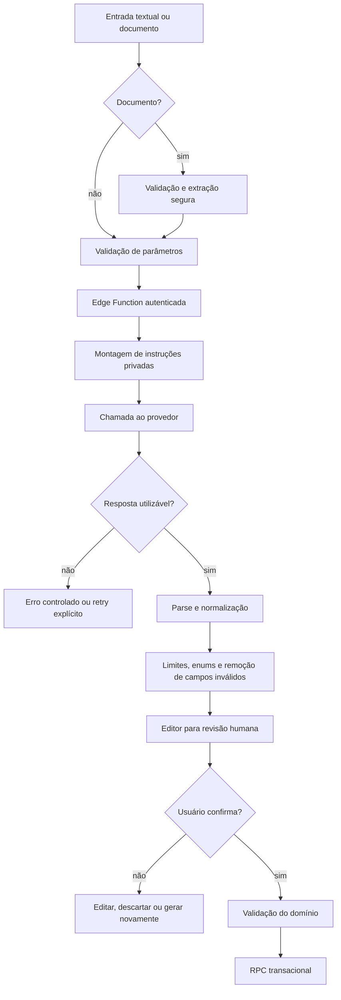

# Fluxo de integração com LLMs

## 1. Princípios

O produto de origem confirma cinco decisões arquiteturais:

1. o navegador nunca recebe a chave privada do provedor;
2. toda chamada exige autenticação e validação server-side;
3. entradas são limitadas antes do consumo de tokens;
4. saídas probabilísticas atravessam normalização determinística;
5. conteúdo gerado só é persistido depois de revisão humana.

O portfólio demonstra normalização, validação e revisão humana a partir de uma fixture JSON versionada. Ele não contém prompts, autenticação, credenciais, adaptador de provedor nem chamada de LLM.

## 2. Fluxo confirmado no produto de origem

Este fluxo documenta a integração real do produto privado; não representa serviços executados pelo portfólio.



### Geração de atividades

1. `app.js` coleta disciplina, série, dificuldade, formatos e material opcional.
2. Arquivos podem passar por `processar-material-atividade` antes da geração.
3. `dados.js` invoca `gerar-atividade-ia`.
4. A Edge autentica, limita o contexto e chama o provedor.
5. `normalizarAtividade` restringe quantidade, tipos, alternativas, resposta, BNCC e tamanhos.
6. `iaInserirNoEditor` transforma a resposta em conteúdo editável.
7. A pessoa revisa e somente depois usa o fluxo de salvamento.

### Planejamento estruturado

O fluxo de planejamento mais recente usa uma ferramenta com input schema e escolha explícita da ferramenta. Ainda assim, o retorno passa pelas mesmas validações de campos obrigatórios e limites antes de chegar ao navegador.

### Leitura multimodal

O leitor recebe imagem ou página PDF preparada, mapa esperado e critérios definidos pela pessoa usuária. A saída é normalizada em estruturas limitadas de respostas, confiança, notas e avisos. Sugestões discursivas permanecem revisáveis.

## 3. Contrato público implementado

O módulo `src/llm/normalize-activity.js` recebe uma resposta simulada e opções públicas:

```text
normalizeActivity(simulatedResponse, {
  quantity,
  allowedTypes,
  distribution
})

=> { titulo, texto_base, aviso, questoes } | null
```

A demonstração lê `demo/fixtures/llm-response.json`, filtra itens inválidos e cria uma revisão pendente. `approveHumanReview` exige identificação da pessoa revisora antes que a persistência simulada aceite o agregado. Não existe adaptador externo neste repositório.

## 4. Validação em camadas

### Antes do provedor

Controles existentes no produto de origem, documentados aqui e não executados pela demo:

- sessão obrigatória;
- perfil válido;
- método HTTP permitido;
- tamanho máximo do documento e do texto;
- enumeração de formatos e dificuldade;
- quantidade máxima de itens;
- truncamento ou rejeição explícita, nunca silenciosa quando houver risco semântico.

### Depois do provedor

No portfólio, a fixture entra exatamente nesta fronteira e percorre o normalizador determinístico:

- seleção apenas de blocos esperados;
- parse de JSON ou tool input;
- confirmação do tipo raiz;
- allowlist de tipos de questão;
- limites de texto, alternativas e habilidades;
- coerência entre tipo e resposta;
- descarte de itens inválidos;
- aviso de quantidade incompleta;
- nenhuma persistência dentro do adaptador de IA.

### Antes da persistência

- revisão humana explícita;
- sanitização do HTML limitado;
- conversão para contrato de domínio;
- validação de pontuação e sequência;
- RPC atômica com owner derivado da sessão.

No recorte executável, o gate de revisão e as validações de domínio são reais; a RPC, a sessão e o banco são substituídos por `SimulatedTransactionStore` e não são apresentados como PostgreSQL em execução.

## 5. Human-in-the-loop

A revisão humana não deve ser descrita como um detalhe visual. Ela é uma fronteira arquitetural:

- a IA sugere conteúdo;
- o normalizador torna a resposta tecnicamente consumível;
- a pessoa valida adequação e corrige o conteúdo;
- o contrato do domínio valida consistência mecânica;
- o banco persiste somente a decisão confirmada.

Nos fluxos de correção, a distinção deve continuar explícita entre transcrição, sugestão original da IA, nota revisada e estado finalizado.

## 6. Riscos, controles e limites do portfólio

| Risco | Controle demonstrado | Limite declarado |
|---|---|---|
| documento hostil | limites, ZIP central directory, timeout e testes inválidos | corpus adversarial amplo não incluído |
| resposta malformada | parse defensivo, allowlists, limites e descarte de itens | normalização não garante correção pedagógica |
| custo indevido | nenhuma chamada externa | quotas de provedor não são demonstradas |
| vazamento em logs | sem telemetria e relatório sintético limitado | observabilidade de produção não é reproduzida |
| dependência de provedor | fixture portável | comportamento probabilístico de modelos não é medido |
| erro pedagógico | revisão humana obrigatória | não há alegação de acurácia pedagógica |

## 7. Conteúdo excluído do repositório público

- system prompts completos;
- exemplos derivados de aulas, provas ou planejamentos reais;
- respostas reais do provedor;
- nomes de modelos usados como garantia de qualidade;
- configuração de produção;
- logs históricos;
- métricas de acurácia não reproduzidas publicamente.
