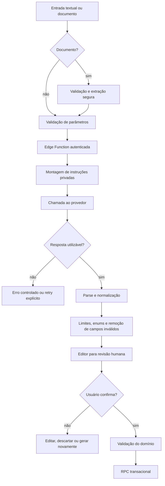

# Fluxo de integração com LLMs

## 1. Princípios

A integração selecionada deve demonstrar cinco decisões:

1. o navegador nunca recebe a chave privada do provedor;
2. toda chamada exige autenticação e validação server-side;
3. entradas são limitadas antes do consumo de tokens;
4. saídas probabilísticas atravessam normalização determinística;
5. conteúdo gerado só é persistido depois de revisão humana.

Os prompts do produto original são privados. A vitrine deverá explicar o contrato e usar prompts mínimos, genéricos e novos somente após autorização.

## 2. Fluxo confirmado no código



### Geração de atividades

1. `app.js` coleta disciplina, série, dificuldade, formatos e material opcional.
2. Arquivos podem passar por `processar-material-atividade` antes da geração.
3. `dados.js` invoca `gerar-atividade-ia`.
4. A Edge autentica, limita o contexto e chama o provedor.
5. `normalizarAtividade` restringe quantidade, tipos, alternativas, resposta, BNCC e tamanhos.
6. `iaInserirNoEditor` transforma a resposta em conteúdo editável.
7. A pessoa revisa e somente depois usa o fluxo de salvamento.

### Planejamento estruturado

O fluxo de planejamento mais recente usa uma ferramenta com input schema e escolha explícita da ferramenta. Ainda assim, o retorno passa pelas mesmas validações de campos obrigatórios e limites antes de chegar ao navegador.

### Leitura multimodal

O leitor recebe imagem ou página PDF preparada, mapa esperado e critérios definidos pela pessoa usuária. A saída é normalizada em estruturas limitadas de respostas, confiança, notas e avisos. Sugestões discursivas permanecem revisáveis.

## 3. Contrato público proposto

O portfólio não precisa expor os prompts. O contrato demonstrável poderá ser:

```text
GenerationRequest
  context: sanitized text
  task: public enum
  constraints: public structured object

GenerationResult
  status: complete | partial | rejected
  items: normalized domain items
  warnings: bounded string list
  providerMetadata: omitted from persistence
```

O adaptador público deverá aceitar uma resposta fixture em vez de chamar o provedor. Um adaptador externo poderá existir como extensão opcional, desabilitada por padrão.

## 4. Validação em camadas

### Antes do provedor

- sessão obrigatória;
- perfil válido;
- método HTTP permitido;
- tamanho máximo do documento e do texto;
- enumeração de formatos e dificuldade;
- quantidade máxima de itens;
- truncamento ou rejeição explícita, nunca silenciosa quando houver risco semântico.

### Depois do provedor

- seleção apenas de blocos esperados;
- parse de JSON ou tool input;
- confirmação do tipo raiz;
- allowlist de tipos de questão;
- limites de texto, alternativas e habilidades;
- coerência entre tipo e resposta;
- descarte de itens inválidos;
- aviso de quantidade incompleta;
- nenhuma persistência dentro do adaptador de IA.

### Antes da persistência

- revisão humana explícita;
- sanitização do HTML limitado;
- conversão para contrato de domínio;
- validação de pontuação e sequência;
- RPC atômica com owner derivado da sessão.

## 5. Human-in-the-loop

A revisão humana não deve ser descrita como um detalhe visual. Ela é uma fronteira arquitetural:

- a IA sugere conteúdo;
- o normalizador torna a resposta tecnicamente consumível;
- a pessoa valida adequação e corrige o conteúdo;
- o contrato do domínio valida consistência mecânica;
- o banco persiste somente a decisão confirmada.

Nos fluxos de correção, a distinção deve continuar explícita entre transcrição, sugestão original da IA, nota revisada e estado finalizado.

## 6. Riscos e controles ainda necessários

| Risco | Controle existente | Controle necessário para a vitrine |
|---|---|---|
| prompt injection em documento | instrução de sistema e normalização | corpus adversarial e separação clara entre conteúdo e instrução |
| resposta malformada | parse defensivo e validação | schema validation reutilizável e testes de mutação |
| custo indevido | limites de entrada | quota por usuário e adaptador mock como padrão |
| vazamento em logs | alguns logs evitam conteúdo | política central de logging e teste de redaction |
| dependência de provedor | gateway server-side | interface independente e fixtures portáveis |
| erro pedagógico | edição humana | avisos explícitos, auditoria da decisão e evals sintéticos |
| mudança de modelo | identificador fixo | configuração versionada e contrato de compatibilidade |

## 7. O que não será publicado sem nova autorização

- system prompts completos;
- exemplos derivados de aulas, provas ou planejamentos reais;
- respostas reais do provedor;
- nomes de modelos usados como garantia de qualidade;
- configuração de produção;
- logs históricos;
- métricas de acurácia não reproduzidas publicamente.
